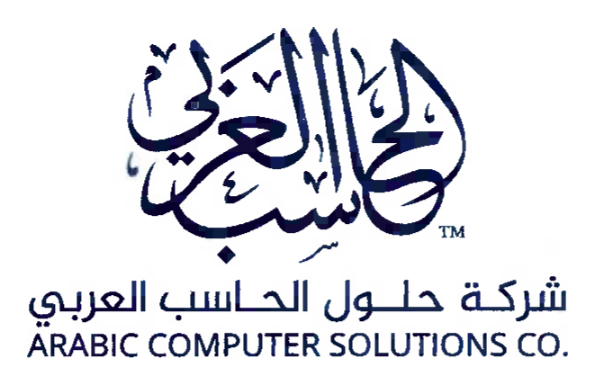
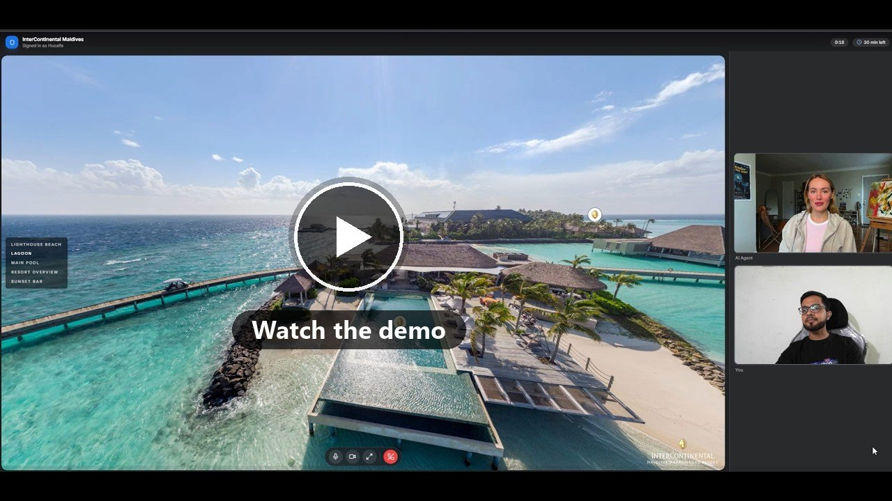
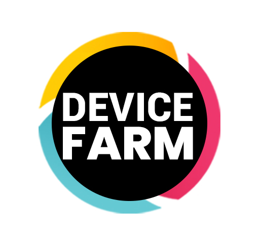
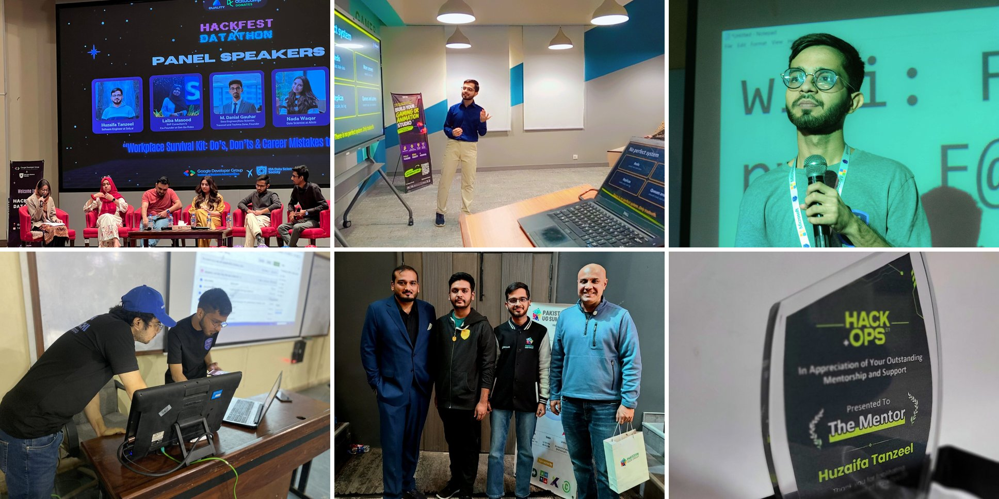

<h1 align="center">Huzaifa Tanzeel</h1>

  <b>Foundational engineer at the intersection of AI, backend, and DevOps</b> 
  I like hard problems, and I like finding better ways to solve them.

  <a href="mailto:hthuzaifatanzeel@gmail.com">Email</a> ·
  <a href="https://linkedin.com/in/huzaifatanzeel">LinkedIn</a> ·
  <a href="https://medium.com/@hthuzaifatanzeel">Medium</a>

---

Hi, I am Huzaifa, a software engineer who has worked across AI, backend, and DevOps in fast-moving startup environments. That mix gave me an end-to-end picture of how a system is built, how it works, and what it takes to keep it running reliably in production, not just the one piece I was assigned. Call it polymath if you like; mostly I just follow the problem wherever it goes.

I am not the engineer who only closes tickets. I want to understand the problem behind the ticket, and I bring ideas and suggestions to the team without waiting to be asked.

## Sofy.ai

Picture a real Android phone, not an emulator, working through a mobile app while nobody touches it. An AI agent reads the screen and decides what to tap. I designed that agent at [Sofy.ai](https://sofy.ai), using the OpenAI Agents SDK and Appium on physical devices. It tests the UI flows of enterprise apps like SAP and Careem.

Elsewhere on the platform, I worked on distributed Java and Spring Boot backend services. On the infrastructure side, I handled DevOps: Ansible deployments across multiple servers, and Prometheus, Loki, and Grafana monitoring the infrastructure and the real Android and iOS devices on the portal, so they stayed stable and available.

 

## Arabic Computer Solutions

At [Arabic Computer Solutions](https://arabic-computer.com) my work covered RAG-based systems and voice AI capabilities. I also handled Linux servers and deployments: dockerized Java and Spring Boot services released from an on-prem GitLab, with Ansible playbooks rolling them out to 10+ VMs at a time.

 

## A side project I enjoyed

An AI avatar that gives a resort tour. A guest talks to a live avatar while moving through a 360° tour of the InterContinental Maldives, and asking for the overwater villa actually takes them there. Built with FastAPI, RAG, PostgreSQL, and Docker Compose.

[▶ Watch the demo](https://youtu.be/s9f5Tx7cSPc)

## Open source

I've contributed to [Awesome LLM Apps](https://github.com/Shubhamsaboo/awesome-llm-apps), a collection of LLM application examples with over 125,000 stars, and to [Appium Device Farm](https://github.com/AppiumTestDistribution/appium-device-farm), an open-source tool for running Appium on real devices.

 

## Toolbox

I also write about [WebRTC](https://medium.com/@hthuzaifatanzeel/understanding-webrtc-a-beginners-guide-to-real-time-communication-on-the-web-2fbe75f7a8e1), [Kubernetes basics](https://medium.com/@hthuzaifatanzeel/kubernetes-basics-components-architecture-5af7345543dc), and [a local Minikube setup](https://medium.com/@hthuzaifatanzeel/minikube-kubectl-local-setup-856497eaa135).

## Outside the 9 to 5

Some of my favorite work has happened off the clock. I was a Microsoft Learn Student Ambassador, running the Microsoft student community at FAST NUCES Karachi. I've given talks on system design, joined panels at university events like HackFest at IBA, and mentored teams at HackOps, where the organizers gave me their Mentor award.

I'm always happy to talk at a meetup, join a panel, or mentor a hackathon team. Reach out if you're organizing one.
